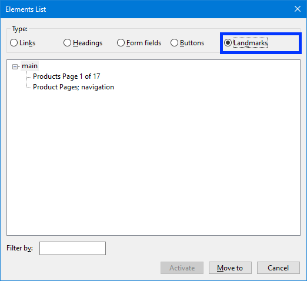
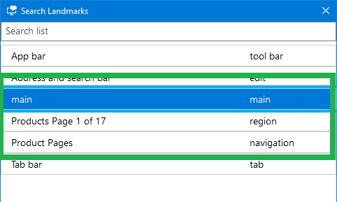
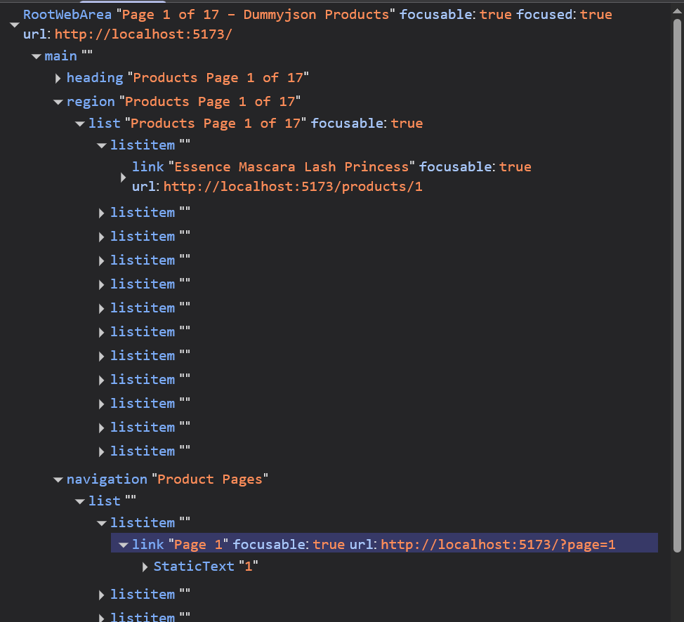
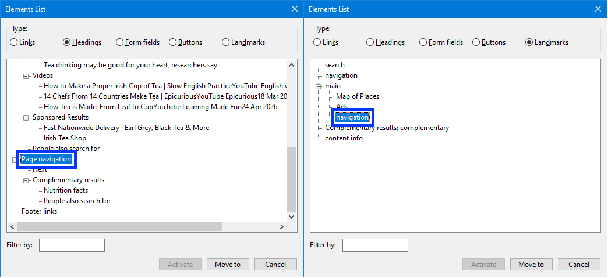
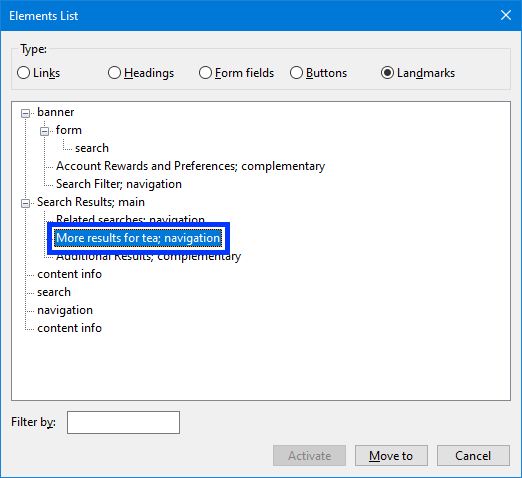
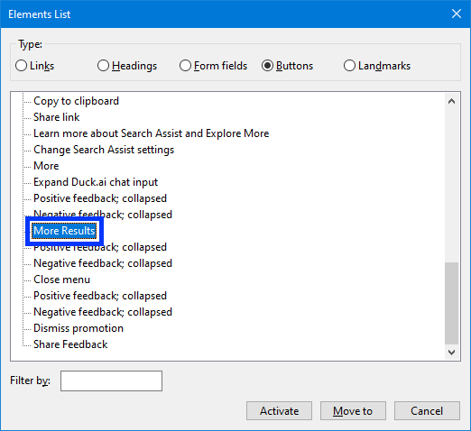

# Investigating Pagination with React

This is a small project that uses product data from [DummyJSON](https://dummyjson.com/docs/products#products-all) to display product information and have more products to page through using the pagination functionality. This was an exploration of *pagination* so the product cards are really just filler and do not necessarily adhere to recommended design guidance.

## Demonstration

Both videos demonstrate screen reader announcements, navigation by respective Elements list, navigation by keyboard and by screen reader commands for landmark and list item navigation.

Click the thumbnail to play the pagination demo with NVDA  
[](https://www.youtube.com/watch?v=3hsjfX-XVYY)

Click the thumbnail to play the pagination demo with Narrator  
[](https://www.youtube.com/watch?v=K5RZ8ctdQ3U)

## Design
The code also contains comments indicating where relevant guidance was actually applied.

### Landmarks
Landmarks for products and pagination are navigable via screen reader keyboard commands e.g. `d` and `Shift+d` to jump between landmarks.  

1. `main` replaces the Vite template's `<div id="root">`
2. The products region is named by the `<h1>` with `aria-labelledby="products-heading"`
3. `<nav>` named `Product Pages` for the pagination

NVDA Elements list:  



Narrator's Elements list (green box outline added by me as Narrator includes Edge browser landmarks in the list):  



### Pagination
1. Pagination uses links, not buttons: buttons are typically for an action on the current page, and links can be opened in a new tab and bookmarked.  
2. Up to 10 page links are shown, in a "sliding window" like Google's (my personal choice).
3. Previous and Next use `rel="prev"` and `rel="next"`, as GOV.UK does.
4. `aria-current="page"` marks the current page.  
5. Focus management: after a page change, focus moves to the product list.
6. React Router keeps the page number in the URL (`?page=N`) so a page can be bookmarked. 
7. The heading and `document.title` both include the current page number to provide additional supporting information to a screen reader.

#### Repeated accessible names
Each page link is named by reusing a hidden "Page" label:

```tsx
<nav aria-labelledby="pagination-label">
  <span id="pagination-label" hidden>Product Pages</span>
  <span id="prefix" hidden>Page</span>
  <ol role="list">
    ...
    <li key={page}>
      <Link
        id={`link-${page}`}
        to={`?page=${page}`}
        aria-labelledby={`prefix link-${page}`}
        aria-current={page === pageNumber ? 'page' : undefined}
      >
        {page}
      </Link>
    </li>
    ...
  </ol>
</nav>
```

- The products are in an *ordered* list, to provide the user with the number of items and lets users move through them with list commands `i` / `Shift+i`. 


### Accessibility tree information


### Keyboard navigation
`Tab` and `Shift+Tab` navigation through products and pages within the pagination control for keyboard users. In a production level application, skip links such as "Jump to products" and "Jump to product pages navigation" would be useful additions.

## WCAG 2.2 success criteria targeted

**Level A:** 1.3.1 Info and Relationships, 2.1.1 Keyboard, 2.4.2 Page Titled, 2.4.3 Focus Order, 2.4.4 Link Purpose (In Context), 2.5.3 Label in Name, 4.1.2 Name, Role, Value

**Level AA:** 2.4.6 Headings and Labels

## Screen reader testing
**OS**: Windows 10 Pro  
**Screen readers**: NVDA 2026.1.1 (2026.1.1.55980), Windows Narrator  
**Browsers**: Chrome 156.0.8078.48 (Official Build) (64-bit), Firefox 159.0 (64-bit), Edge 156.0.4314.50 (Official build) (64-bit)

## Tech stack
- React
- React Router
- TypeScript 
- Vite

## How to run
1. Install dependencies: `npm install`
2. Launch the dev server: `npm run dev`

## How does "Big Search" do it?

Things change a lot but at time of writing things (October 30th 2026), I took a look at how some search engines handle pagination for their search results. I've stripped out a lot of the enormous `href` values, inline styles and other unnecessary content to keep the focus on the structure of their pagination. 

The search term I used was "tea" (no particular reason other than it generates a lot of result pages) and the screen reader I used was NVDA.

### Google search

Suppresses the `table` semantics, exposes page navigation as a heading AND as a landmark. `Previous` and `Next` are exposed as *subheadings*.

```
<div role="navigation">
    <h1 class="bNg8Rb">Page navigation</h1>
    <table role="presentation">
        <tbody>
            <tr>
                <td aria-level="2" role="heading">
                    <a href="/search?q=tea" id="pnprev">
                        <span class="D2pCqd CsrMc"></span>
                        <span class="DHTy1e">Previous</span>
                    </a>
                </td>
                <td class="bQkv1e">
                    <a aria-label="Page 1" class="fl" href="/search?q=tea">
                        <span class="D2pCqd CsrMc"></span>
                        1
                    </a>
                </td>
                ...
                <td aria-level="2" class="BBwThe" role="heading">
                    <a class="KLlkp" href="/search?q=tea" id="pnnext" >
                        <span class="D2pCqd CsrMc"></span>
                        <span class="DHTy1e">Next</span>
                    </a>
                </td>
            </tr>
        </tbody>
    </table>
</div>
```



### Bing

Almost everything is returned inside a ginorous `<ol>` with the navigation understandably down near the very bottom of that list. It is exposed as a landmark to NVDA.

```
...
<ol id="b_results" class>
  ...
  <li class="b_pag" data-bm="19">
    <style type="text/css">...</style>
    <nav role="navigation" aria-label="More results for tea">
      <h4 class="b_hide">Pagination</h4>
      <ul class="sb_pagF">
        <li>
          <a aria-label="Page 1" class="sb_pagS sb_pagS_bp b_widePag sb_bp sb_pag_first">1</a>
        </li>
        <li>
          <a class="b_widePag sb_bp" aria-label="Page 2" href="/search?q=tea>2</a>
        </li>
        <li>
          <a class="b_widePag sb_bp" aria-label="Page 3" href="/search?q=tea>3</a>
        </li>
        <li>
          <a class="sb_pagN sb_pagN_bp b_widePag sb_bp " aria-label="Next page" title="Next page" href="/search?q=tea">
            <div class="sw_next">Next</div>
          </a>
        </li>
      </ul>
    </nav>
  </li>
  ...
</ol>
```



### Duckduckgo

There is no navigation landmark. There is a "More results" button that NVDA reports as being **39th** in a list of 46 buttons.

```
<div class="rdxznaZygY2CryNa5yzk">
  <button 
    type="button" 
    class="wE5p3MOcL8UVdJhgH3V1 fIgpqHfKgUmmk5lqmvL5 _I0sotAoeGtAJzkzyutg HjmVHoysMVa18x3TnLh_ h3Hp5vVXWdx4K2nUEN5l" 
    id="more-results"
    >
      More results
    </button>
</div>
```



## Pagination Advice

- [GOV.UK Design System: Pagination](https://design-system.service.gov.uk/components/pagination/)
- [Primer: Pagination accessibility](https://primer.style/product/components/pagination/accessibility/)
- [eBay Evo: Pagination accessibility](https://opensource.ebay.com/evo-web/components/pagination/accessibility)
- [eBay MIND Patterns: Pagination](https://ebay.gitbook.io/mindpatterns/navigation/pagination)
- [Boston Scientific: Pagination](https://ads.bsci.com/components/pagination)